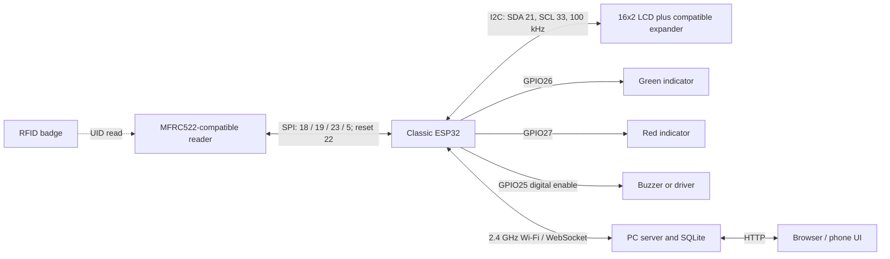
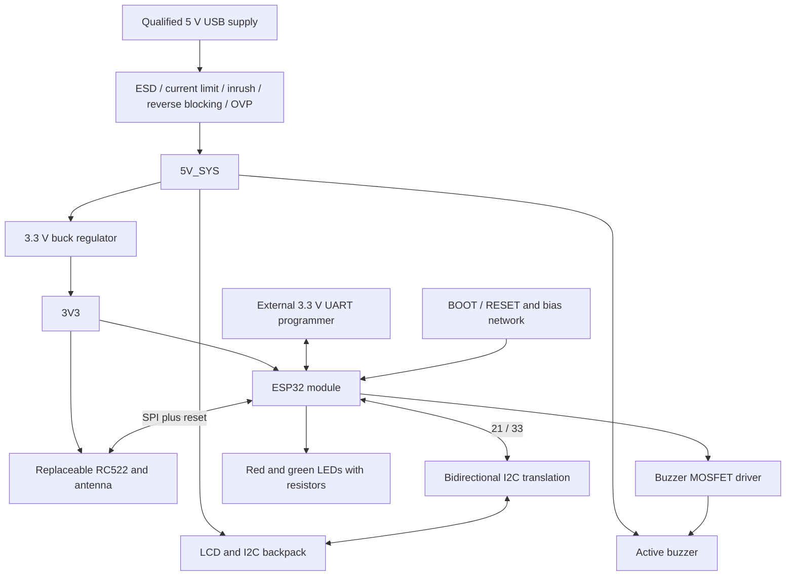

# Checker PCB Requirements and Hardware Audit

**Ravena | Revision 1 | 2026-11-23 | Requirements baseline, not a fabrication release**

Repository baseline: `ed4c3a2` (2026-10-20, initial CheckerV2 snapshot), with the local hardware configuration inspected separately. Scope: static repository audit, manufacturer-document checks, architecture, requirements BOM, and validation plan. No firmware changes, hardware measurements, flashing, or PCB design files are part of this audit.

Evidence labels used throughout:

- **CONFIRMED — repository:** directly established by executable source/configuration. This does not prove the connected physical hardware or flashed binary matches it.
- **CONFIRMED — datasheet:** verified for the named manufacturer's part and stated conditions, not automatically for an unidentified module or clone.
- **INFERRED:** engineering interpretation supported by evidence but not physically verified.
- **NEEDS VERIFICATION:** unresolved part identity, measurement, mechanical detail, procurement information, or acceptance criterion.
- **PROPOSED:** design requirement or recommendation for the new PCB, not a description of the existing prototype. Provisional values require review before schematic/BOM release.

## 1. Project Overview

CheckerV2 is an RFID attendance and badge-assignment terminal. The ESP32 reads badge UIDs and communicates over Wi-Fi/WebSocket with a PC. The PC owns event state, attendance decisions, and SQLite storage; the terminal provides reader, LCD, LED, and audible feedback. The design must preserve this division of responsibilities. Sources: [main.cpp](firmware/src/main.cpp), lines 355–420, 563–628; [server/app.js](server/app.js), lines 394–462; [architecture](docs/ARCHITECTURE.md), lines 3–57.

**Principal findings:**

1. **CONFIRMED:** active firmware uses a classic ESP32 build target, MFRC522-compatible reader on SPI, a 16×2 HD44780-compatible display through an I²C expander, two status-LED outputs, and one digital buzzer output.
2. **CONFIRMED:** LCD SDA is **GPIO21**, SCL is **GPIO33**, at **100 kHz**. GPIO22 is the RFID reset line. The parallel LCD wiring in the README and configuration names is obsolete for the current implementation.
3. **NEEDS VERIFICATION:** physical board/module identities, existing supply wiring, LCD pull-up voltage, buzzer type/driver, LED resistors, currents, and enclosure dimensions. None can be certified from firmware.
4. **PROPOSED:** use an integrated classic ESP32 module PCB for the production direction; retain a replaceable qualified RC522 module and LCD/backpack for revision A. Provide protected USB power, a suitably rated 3.3 V regulator, I²C voltage translation, buzzer driver, and service/programming access.
5. **Release restriction:** this is an engineering input to schematic development. Open component and mechanical decisions must be resolved before manufacture; the BOM below is functionally complete but not a purchase-ready BOM.

## 2. Existing Project Audit

### 2.1 Scope and evidence hierarchy

The workspace was inventoried recursively, including ignored local firmware configuration, cached libraries/build metadata, documentation, generated presentation assets, and unrelated directories. Relevant application sources, hardware dependencies, scripts, and hardware documentation were inspected. No KiCad/Eagle/Fritzing schematic, PCB, Gerber, mechanical CAD, wiring drawing, or manufacturing BOM was found. The README pin table is documentation, not a verified wiring drawing.

| Area | Evidence and audit result |
|---|---|
| Active firmware | [main.cpp](firmware/src/main.cpp), [CheckerLcdDisplay.cpp](firmware/src/CheckerLcdDisplay.cpp), [CheckerLcdDisplay.h](firmware/include/CheckerLcdDisplay.h); the only application implementation in `firmware/src` |
| Build selection | [platformio.ini](firmware/platformio.ini), lines 11–19: one environment, `esp32dev`, Arduino, serial monitor 9600 baud; [build script](scripts/build-firmware.ps1), lines 1–4 selects it explicitly |
| Actual local hardware definitions | `firmware/include/CheckerV2Config.h`, lines 8–27: compared with the example; GPIOs and active-high flags agree, LCD enabled. Credentials were not reproduced in this document |
| Public defaults | [example configuration](firmware/include/CheckerV2Config.example.h), lines 12–32; stale parallel LCD names remain |
| Dependencies requested | ArduinoJson `^7.2.1`, MFRC522 `^1.4.11`, hd44780 `^1.3.2`; platform itself is unpinned |
| Local dependency evidence | `firmware/.pio/libdeps/esp32dev/*/library.properties`, line 2: ArduinoJson 7.4.3, MFRC522 1.4.12, hd44780 1.3.2. Cached files are not a reproducible lockfile |
| Installed toolchain context | Local `.platformio/platforms/espressif32/platform.json`: 6.13.0. Framework package: `3.20017.241212+sha.dcc1105b` (Arduino ESP32 2.0.17). Cached `firmware/.pio/build/esp32dev/idedata.json` records IDF `v4.4.7-dirty`. These are local observations, not guaranteed versions on another machine |
| Hardware libraries | MFRC522 SPI/reset implementation and `hd44780_I2Cexp` expander detection inspected. `firmware/lib`, `include/README`, and `test/README` contain PlatformIO boilerplate, not additional hardware or actual test cases |
| Server/UI | [server/app.js](server/app.js), especially lines 394–462, 784–790, 842–889; browser status/recovery/assignment paths in [UI](server/public/checker-ravena.html). These determine valid hardware test conditions, not electrical wiring |
| Setup scripts | Build/upload/configuration scripts and server startup/diagnostics reviewed. Upload uses a selected serial port; no USB device identity is specified by these scripts |
| Existing documentation | README, PROJECT_GUIDE, ARCHITECTURE, MIGRATION, FEATURE_PARITY, TEST_RESULTS reviewed. Documentation contradictions are resolved against active code |
| Presentation material | [presentation source](output/pdf/checker-presentation.html), [notes](output/pdf/NOTES.md), and [prototype photograph](output/pdf/screenshots/prototype.jpg). Exterior photo shows display window and red/green indicators; internal electronics, measurements, and exact MPNs are not visible. The PDF is a generated presentation, not a schematic |
| Excluded from electrical evidence | Live event databases, generated demo databases/screenshots, PDF rendering dependencies, and unrelated `work/malek_reel_*` video assets. Their presence supplies no hardware specification |

### 2.2 Latest active implementation versus historical descriptions

**CONFIRMED:** the current source advertises firmware string `checkerv2-esp32-1` and protocol 1 in `main.cpp:355–365`. This is not a unique release identifier for the LCD change. Only one Git commit was present; a detailed sequence of earlier firmware revisions cannot be reconstructed from this repository's history. Cached binaries and file timestamps do not prove what is flashed on the device.

| Historical/stale description | Current evidence and consequence |
|---|---|
| CheckerV0 hosts UI/data on the ESP32 | [MIGRATION](docs/MIGRATION.md):3–45 and [FEATURE_PARITY](docs/FEATURE_PARITY.md):3–5, 29–30 describe migration. CheckerV0 source is not inside this workspace. Do not add SD storage, local web hosting hardware, or RTC based on the older architecture |
| Parallel LCD keypad shield on GPIO21/33/4/14/13/32 | `README.md:54–74`, `PROJECT_GUIDE.md:766–775`, config/header names. **Superseded:** `CheckerLcdDisplay.cpp:4–11,109–114` uses `hd44780_I2Cexp` and `Wire.begin(21,33,100000)` |
| GPIO4 described as boot strap | `README.md:72–73` is inaccurate for classic ESP32. The documented straps are GPIO0, 2, 5, 12, 15; GPIO4 is also unused by this LCD implementation. See [ESP32 datasheet][D1], boot configuration section |
| Duplicate result flashes green twice | `docs/FEATURE_PARITY.md:27` disagrees with `main.cpp:212`, which pulses **red** twice |
| Bad result produces a longer buzzer pulse | `PROJECT_GUIDE.md:799–802` describes intent; `main.cpp:213–214` restores `onMs` before asynchronous pulse execution. See section 12 |
| Previous successful build proves hardware works | [TEST_RESULTS](docs/TEST_RESULTS.md):20,36–43,68–86 explicitly separates compilation/simulation from unperformed physical scans and recovery tests. No new hardware test was performed here |

## 3. Confirmed Hardware Architecture

The following diagram represents firmware-required interfaces. Power rails are proposals/physical checks, not recovered facts about existing wiring.

Evidence: `main.cpp:39–44,191–214,447–482,631–655`; `CheckerLcdDisplay.cpp:4–11,109–114`; `server/app.js:394–462,842–889`.

- **CONFIRMED:** reader polling, no application IRQ handler; no keypad input, battery measurement, charger, power switch controller, SD card, Ethernet hardware, or RTC interface appears in the active firmware.
- **CONFIRMED:** Wi-Fi station mode uses `WiFi.setSleep(false)` (`main.cpp:447–464`). Budget for an awake radio and continuously enabled reader field, not deep-sleep current.
- **INFERRED:** an active buzzer or oscillator-equipped module is needed for a sustained tone with the current digital pulse code; an ordinary passive transducer alone will not reproduce it.
- **NEEDS VERIFICATION:** ESP32 development-board manufacturer, module marking, USB connector and USB-UART bridge; the build name `esp32dev` identifies a software target, not a physical board SKU.

## 4. Complete Component Inventory

### 4.1 Existing prototype interfaces and electrical evidence

Unknown electrical values below remain unknown; proposed budget allocations in section 6 are not measurements.

| Component and purpose | Identity/status | Voltage | Typical / maximum current evidence | Interface and GPIOs |
|---|---|---|---|---|
| ESP32 processing/Wi-Fi board | **CONFIRMED** classic `esp32dev` target; physical board and module **NEEDS VERIFICATION** | 3.3 V logic required; existing board input/regulator wiring unknown | Existing board typical/max unknown, including its regulator/bridge/LEDs. For proposed WROOM-32E only: 239 mA average / 379 mA peak for 802.11b TX at 19.5 dBm, 3.3 V, 25°C, 100% TX duty; not a universal worst case. [Module datasheet][D2], table 16 | SPI, I²C, GPIO, UART0; section 5 |
| RFID reader | **CONFIRMED** MFRC522 driver/protocol; exact RC522 PCB/IC authenticity and revision **NEEDS VERIFICATION** | Propose regulated 3.3 V module supply. MFRC522 IC main rails 2.5–3.6 V, nominal 3.3 V; do not supply an unidentified module with 5 V | IC at 3 V: digital 6.5 typ/9 max mA; analog receiver enabled 7/10 mA; transmitter CW 60/100 mA; PVDD up to 40 mA, SVDD up to 4 mA under stated conditions. These are separate domain figures, **not** a measured module total. [MFRC522 datasheet][D3], tables 1,151,153 | SCK18, MISO19, MOSI23, NSS5, NRSTPD22; no assigned IRQ |
| 16×2 LCD and backpack | **CONFIRMED** `hd44780_I2Cexp`, 16 columns/2 rows; exact LCD controller, expander, address, backlight **NEEDS VERIFICATION** | Existing voltage unknown. 5 V assembly assumed for proposed design, requiring translation; only a fully qualified assembly may instead use 3.3 V | LCD logic, backpack, and backlight total typical/max unknown; measure backlight-on current separately. PCF8574 standby specification is not the display's operating current | SDA21, SCL33 at 100 kHz; address auto-detected |
| Green status LED | **CONFIRMED** output role and active-high setting; exact LED unknown | LED forward voltage unknown; proposed drive from 3.3 V GPIO through resistor | Existing typical/max unknown; proposed 2–5 mA target after brightness and GPIO checks | GPIO26 output |
| Red status LED | **CONFIRMED** output role and active-high setting; exact LED unknown | As above; select resistor independently from green | Existing typical/max unknown; proposed 2–5 mA target | GPIO27 output |
| Audible indicator | **CONFIRMED** digital output; active oscillator **INFERRED**; exact buzzer/module/driver unknown | Existing rated voltage unknown; proposed 5 V active buzzer driven by transistor | Typical, startup, maximum current unknown; measure and obtain chosen part datasheet | GPIO25, active high |
| LED resistors and possible buzzer electronics | **Required electrically**, physical presence/values **NEEDS VERIFICATION** | Ratings determined by chosen loads | Calculate resistor dissipation and driver current; no values recoverable from software | In series with LEDs; transistor between buzzer and ground if required |
| USB input, onboard regulator and programmer | **INFERRED** development-board facilities from build/upload workflow; actual power path **NEEDS VERIFICATION** | USB candidate nominal 5 V; ESP32/RFID 3.3 V | Existing supply capacity, quiescent overhead, thermal limits and peak consumption unknown | No USB data protocol in application; service uses serial |
| Interconnects, ground, enclosure and mounting | Exterior enclosure/indicators visible in photograph; internal wiring and connectors **NEEDS VERIFICATION** | Common ground required; do not infer pin order from wire color | Contact ratings must cover section 6 budget | Physical continuity survey needed |
| Badges | **CONFIRMED** UID read path (`main.cpp:563–575`); exact badge IC unknown | Passive contactless medium; no wired power | Not a PCB supply load to sum independently of reader RF draw | MFRC522 is 13.56 MHz ISO/IEC 14443 A/MIFARE/NTAG frontend [D3]; firmware does not establish universal NFC/phone support |

### 4.2 Required support, mounting and replacement options

| Component | Supporting electronics to check/provide | PCB mounting approach | Replacement/compact alternative and compatibility |
|---|---|---|---|
| ESP32 board | Verified 3.3 V regulation, decoupling, EN/boot network, programming access | Option A: measured, retained sockets; Option B: castellated module with correct ground-pad pattern | **PROPOSED** ESP32-WROOM-32E-N4 candidate, 4 MB flash, no PSRAM requirement. Match build/flash settings and verify order code. C3/S3 are not drop-in GPIO/firmware replacements |
| RC522 assembly | Module should include its oscillator, RF matching, antenna, decoupling; add local supply capacitors, reset/CS bias as needed | Keyed short cable or supported header plus mounting hardware, antenna facing scan window | Smaller qualified module can preserve protocol. Bare-reader integration requires oscillator, RF network and antenna validation. A newer reader family requires a separate driver/qualification effort |
| LCD assembly | Pull-ups, voltage translation, contrast setting, backlight resistor/driver usually on backpack; inspect, do not duplicate blindly | Locking four-wire connector; display mechanically fixed to front panel | Qualified compact I²C HD44780 assembly is closest replacement. OLED requires display-driver/UI changes and is optional |
| Red/green LEDs | One calculated series resistor each; optional off-state bias if boot glow is unacceptable | Through-hole panel-visible LEDs or SMD plus light pipes, depending on enclosure | Efficient smaller LEDs need no firmware change if polarity and visibility preserved |
| Buzzer | Logic-level MOSFET or qualified module input; gate resistor/pulldown; clamp for inductive device | Board mounted with sound opening or keyed external connector | Small self-driven piezo buzzer preserves digital enable; passive piezo requires PWM/tone firmware changes |
| Power/programming | Input protection, regulator support network, service pads/buttons | Mechanically anchored USB connector, reflowed regulator, test-accessible UART | External 3.3 V UART programmer lowers per-unit BOM; onboard USB-UART improves service convenience but adds components |
| Harness/mechanics | Matched connector housings/crimps, strain relief, insulating spacers | Through-hole connector anchors where practical | Shorter locked harnesses improve repairability and reduce intermittent wiring faults |

**Lifecycle finding:** NXP currently marks MFRC522 as not recommended for new designs. Retaining a replaceable module is a deliberate compatibility compromise for the first PCB, not a long-term component-lifecycle recommendation. Obtain traceable supply for the pilot; evaluate a supported reader before scaling. Availability and Tunisian procurement prices were not verified. [NXP product status][D8]

**LCD expander identity is not established:** local `hd44780_I2Cexp.h:26–50,360–385` supports PCF8574 and MCP23008 families with auto-discovery. Do not label the prototype PCF8574/0x27 merely because those are common. [TI PCF8574 datasheet][D4] is a conditional voltage-compatibility reference, not identification of the installed part.

## 5. Firmware and GPIO Pin Mapping

### 5.1 Complete active signal map

Directions are relative to ESP32. Numbers are **GPIO identifiers**, not development-board header positions or ESP32-module pad numbers.

| ESP32 GPIO | Connected component | Signal | Direction | Notes |
|---|---|---|---|---|
| 18 | RFID | SCK | Output | `CHECKER_SPI_SCK_PIN`; SPI clock |
| 19 | RFID | MISO | Input | `CHECKER_SPI_MISO_PIN`; 3.3 V reader response |
| 23 | RFID | MOSI | Output | `CHECKER_SPI_MOSI_PIN` |
| 5 | RFID | NSS / SS / CS | Output, active low | `CHECKER_RC522_SS_PIN`; some modules label this **SDA**, but it is SPI chip select here. ESP32 strap pin; preserve reset-time default high |
| 22 | RFID | NRSTPD / RST | Input during library startup, output if hardware reset needed | `CHECKER_RC522_RST_PIN`; active-low reader reset/power-down. Not ESP32 EN; not LCD SCL |
| 21 | LCD backpack | SDA | Bidirectional, open-drain bus | Literal in `Wire.begin`; voltage translation if backpack pull-ups are 5 V |
| 33 | LCD backpack | SCL | Master clock output/open-drain bus | Literal in `Wire.begin`; 100 kHz, pull-up required |
| 26 | Green LED | GREEN | Output | Active high in local/example config |
| 27 | Red LED | RED | Output | Active high; also used for duplicate/already feedback |
| 25 | Buzzer/driver | BUZZ_EN | Output | Active high, DC on/off pulses, no tone generation |
| 1 / U0TXD | Service interface | UART TX | Output | **INFERRED** from classic ESP32 default `Serial`; 9600 application baud. Reserve for logs/programmer; verify physical header |
| 3 / U0RXD | Service interface | UART RX | Input | **INFERRED** default UART0; commands/programming |
| 0 | Boot button/programmer | BOOT | Strap input | **PROPOSED/reserved**, not an application peripheral assignment |
| EN / CHIP_PU (not GPIO) | Reset button/network | MCU enable/reset | Input | **PROPOSED/reserved**; onboard circuitry identity unknown |
| None assigned | RFID | IRQ | Not used | Leave unconnected in baseline; do not invent GPIO or tie output to ground |
| None | All powered parts | GND | Power return | Required common reference; actual harness continuity to check |
| None | ESP32, reader, low-side I²C pull-ups | 3V3 | Power | Proposed regulated rail; not established by GPIO code |
| None | LCD, selected active buzzer | 5V_SYS | Power | Proposed protected USB-derived rail, subject to part selection |

Pin evidence: local config lines 8–21; [public example](firmware/include/CheckerV2Config.example.h):12–26; `main.cpp:39–44,631–655`; `CheckerLcdDisplay.cpp:111`; cached `MFRC522.cpp:198–223`. MFRC522 library samples RST as input and may leave it an input when already high: provide/check a defined reader reset bias rather than assuming the MCU always drives it.

The cached MFRC522 library default is **4 MHz SPI, MSB first, mode 0** (`MFRC522.h:21–22` and `MFRC522.cpp` SPI transactions). No project override was found. Recheck after dependency updates.

The LCD library calls `Wire.begin()` again (`hd44780_I2Cexp.h:378`). In the inspected installed Arduino core, `Wire.cpp:278–303` returns successfully when the bus is already initialized, so it does not replace the explicit GPIO33 clock with default GPIO22. Validate this behavior when changing core versions.

### 5.2 Available and restricted pins

**CONFIRMED:** ten distinct application GPIOs are actively assigned. There is no numeric GPIO conflict in the present source. Legacy LCD macros do not allocate hardware unless code uses them.

| GPIO group | Assessment for a classic ESP32 module |
|---|---|
| 4, 13, 14, 32 | Unused by current application despite legacy LCD definitions; candidate expansion pins after physical continuity check. GPIO13/14 overlap JTAG functions |
| 16, 17 | Unused application pins; available only after verifying module variant and PSRAM/internal connections |
| 0, 2, 12, 15 | Unused by application but strapping/debug constraints apply; reserve rather than casually use. GPIO12 high at reset can select an incompatible flash supply configuration |
| 5 | Already reader CS and a strap controlling SDIO-slave timing; not the boot-mode selector. External loading must preserve intended strap state |
| 1, 3 | Reserve UART0; not free if serial programming and diagnostics are retained |
| 6–11 | Flash interface on ordinary WROOM designs; do not expose as general-purpose peripherals |
| 34, 35, 36, 39 | Input-only candidates, no internal pull-up/pull-down; require external bias. Cannot replace LED/buzzer/SCK/SDA/SCL outputs |
| 37, 38 and other numeric gaps | Do not assume exposed/usable on the selected module or dev board |

Restrictions are from [ESP32 datasheet][D1], GPIO and boot sections. Physical header availability remains **NEEDS VERIFICATION**. ADC2 analog use conflicts with Wi-Fi operation on classic ESP32; this does not prevent the current digital use of those pins. Do not add battery measurement there without a separate design review. See [Espressif ADC/Wi-Fi limitations](https://docs.espressif.com/projects/esp-idf/en/v4.2.5/esp32/api-reference/peripherals/adc.html).

### 5.3 Wiring risks and mandatory physical checks

- Measure LCD SDA/SCL idle voltage **at the ESP32 side** before connecting unidentified 5 V hardware. Confirm resistor networks and any existing translator.
- Verify GPIO5's reset-time voltage and RC522 board loading; a resistor pulling CS high must reference 3.3 V, not 5 V.
- Confirm reader RST bias and continuity. Software soft reset is not guaranteed to recover a reader that has lost power or whose SPI interface is electrically stuck.
- Confirm LED resistor presence/value/polarity and buzzer drive circuit with power off. Avoid using GPIO drive-strength figures as a buzzer power rating.
- Measure the ESP32 board header rows/pin order and distinguish VIN, USB VBUS, 3V3, EN, and ground. Never assume a universal 30-pin or 38-pin footprint.
- Verify the four-wire display connector order and the RC522 module's actual header order. GPIO21/33 are not RS/Enable in the current firmware.

## 6. Electrical Requirements

### 6.1 Existing supply and proposed rails

**CONFIRMED:** firmware contains no rail sensing, charging, explicit power sequencing controller, or application sleep mode. `main.cpp:631–655` initializes outputs off, waits 600 ms, starts the display, then SPI/reader. Off-state initialization does not control GPIO behavior before `setup()`.

**NEEDS VERIFICATION:** the existing supply source, USB cable, development-board regulator type, whether the LCD is fed from USB/VIN/another supply, reader decoupling, and protection. The old README's 5 V LCD instruction is not proof of actual voltage.

**PROPOSED rails:**

| Net | Loads | Requirement |
|---|---|---|
| USB_5V_IN | Input protection only | Nominal 5 V input; approved adapter/cable and connector rating; no higher-voltage PD request |
| 5V_SYS | LCD/backpack, 5 V active buzzer, buck input, power indicator | Protected and current-limited; acceptable min/max derived from chosen LCD/buzzer and cable/protection losses |
| 3V3 | ESP32 module, RFID module, low-side I²C pull-ups, status LEDs | Target 3.3 V ±5% at load as an engineering design target; no excursions beyond component operating limits; WROOM-32E specified 3.0–3.6 V [D2] |
| GND | All circuits | Continuous return except explicit RF antenna copper keep-outs; avoid buzzer/switcher currents flowing through reader signal return |

### 6.2 LCD level compatibility

**PROPOSED baseline:** keep the qualified LCD/backpack at 5 V and translate **both** SDA and SCL between 3.3 V and 5 V using a bidirectional open-drain level shifter. Two suitably specified small MOSFETs with pull-ups on each side are one implementation. In the conventional circuit: gates to 3.3 V, sources to low-voltage bus, drains to high-voltage bus. Confirm pinout, low-voltage conduction, off-state behavior and power sequencing. [Nexperia AN10441][D5]

If the backpack is PCF8574, its specified VIH minimum is 0.7×VCC: at 5 V this is 3.5 V. Moving pull-ups to 3.3 V while leaving the expander at 5 V therefore does **not** establish a guaranteed logic high. Direct 5 V bus pull-ups are unsuitable for ESP32 I/O. [PCF8574 operating conditions][D4]; [ESP32 module DC limits][D2]

An all-3.3 V display is acceptable only after verifying the LCD controller, expander, contrast generation, backlight and startup behavior together. Do not assume every LCD1602 operates correctly at 3.3 V.

**PROPOSED pull-up starting point:** 4.7 kΩ per line per side, adjusted for installed backpack resistors. Do not blindly parallel another 4.7 kΩ onto unknown values. For a first-order bus model, `tr ≈ 0.8473 × Rp × Cbus`; at 100 pF and 4.7 kΩ, `tr ≈ 0.40 µs`. Check the 100 kHz timing limits, line capacitance, translator effects and low-level sink current, including current from both sides. Use external pull-ups, not the ESP32's weak internal bias as the production bus design.

### 6.3 Power budget: measured values pending

There is no defensible measured typical system current in the repository. The following are **PROPOSED design allocations**, deliberately distinct from documented component consumption. Replace them with measurements and guaranteed part limits before selecting the final input/protection ratings.

| Load | Rail | Provisional allocation | Rationale / outstanding check |
|---|---|---:|---|
| ESP32 module | 3.3 V | 500 mA | Supply capability allowance, **not** measured consumption or a universal maximum; follows Espressif's minimum supply-capability recommendation [D6] |
| Qualified RC522 module | 3.3 V | 200 mA | Engineering reserve above documented IC domain figures; qualify actual module and antenna/load behavior |
| Status LEDs, I²C low-side pull-ups, small logic reserve | 3.3 V | 30 mA | Proposed load allowance; covers both LEDs on for electrical qualification |
| LCD/backpack including backlight | 5 V | 150 mA | Assumption requiring selected display confirmation |
| Active buzzer | 5 V | 50 mA | Assumption requiring startup/continuous current confirmation |
| Power LED and input-control overhead | 5 V | 10 mA | Provisional reserve |
| **Total allocated 3.3 V output** | | **730 mA** | Select regulator with at least 1 A usable capacity under enclosure/temperature conditions; 2 A nominal candidate gives headroom |

Illustrative conversion using an **assumed 85% buck efficiency**, not a guaranteed datasheet efficiency:

`I_USB ≈ (3.3 V × 0.730 A)/(5 V × 0.85) + 0.150 A + 0.050 A + 0.010 A = 0.777 A`.

At an assumed 4.75 V converter input, it is approximately 0.807 A. Nominal allocated input power is approximately 3.89 W. This excludes uncontrolled input-capacitor inrush; it is an upper planning scenario, not a claim that typical Checker consumption is 0.78 A. Target an approved 5 V source with at least 1 A available **under its actual USB power arrangement**. Recalculate if any allocation is exceeded.

### 6.4 Regulation, capacitance and thermal requirements

**PROPOSED candidate:** Diodes AP63203 fixed 3.3 V synchronous buck, TSOT26, nominal 2 A, 3.8–32 V input. Manufacturer reference circuit uses 3.9 µH, 10 µF input, 2×22 µF output and 100 nF bootstrap capacitor; FB senses the regulated output directly. These are a starting network, not a released design. [AP63203 datasheet][D7], figure 21/table 2.

Check at the actual protected USB minimum voltage, peak load, startup, light load and enclosure temperature. Select inductor saturation/thermal ratings against ripple and fault current, capacitor **effective** capacitance after DC bias, regulator stability limits, and exact footprint. Keep switching noise away from both antennas. A 2 A IC label does not guarantee 2 A operation on an arbitrary PCB.

An LDO is simpler but its loss is `(Vin−Vout)×I`: at 5 V to 3.3 V and 0.730 A, about **1.24 W**; at 0.300 A, **0.51 W**. These calculated examples explain why the buck is preferred for a small enclosed unit. An LDO alternative requires measured duty cycle, thermal calculations and temperature validation; do not select a generic development-board regulator without those checks.

Additional **PROPOSED** decoupling: 100 nF plus 10 µF at ESP32 supply entry; 100 nF plus 10 µF at reader connector; 100 nF plus 10 µF near display power connector; 100 nF plus 10 µF near buzzer supply. Confirm existing module capacitors and tune from rail measurements. Espressif recommends local decoupling and at least 10 µF at the main power entrance [D6]. Place bulk capacitance behind controlled inrush protection; adding a large capacitor directly to USB VBUS is not a substitute for a good regulator.

### 6.5 USB and protection

- **PROPOSED low-cost baseline:** mechanically retained USB-C **power-only** receptacle, separate 5.1 kΩ Rd from CC1 and CC2 to ground, unused data pins explicitly marked NC. Reserve UART service access separately. Two Rd resistors advertise a sink; they do not negotiate arbitrary current or USB PD. [Renesas USB-C explanation][D9]
- **Power-source release gate:** the provisional budget exceeds ordinary 500 mA USB power. Baseline deployment must include a qualified dedicated 5 V adapter/cable combination with documented available current. Do not claim arbitrary PC-port or arbitrary USB-C source compatibility. If universal USB input is required, add CC-current detection/appropriate USB charging detection or a sink controller and enforce available-current limits before enabling loads. Two resistors alone cannot implement that feature.
- Provide a protected input path with current limit, controlled rise/inrush, reverse-current blocking and overvoltage handling appropriate to the 5 V loads. A selected eFuse/protection IC may integrate these; otherwise include the required external FETs/control network. Final topology/MPN is a schematic gate.
- Set current-limit minimum above validated normal load/inrush requirements and its maximum below connector/cable/PCB safe current, including tolerance and temperature. Overvoltage cutoff must be above allowed source voltage and below downstream damage thresholds with response overshoot accounted for. A generic “5 V TVS” does not prove this coordination.
- Place ESD/transient protection at VBUS/CC connector entry. Choose TVS standoff above normal voltage and clamping compatible with the protected path. Check leakage/capacitance on CC and current-limit coordination under sustained faults.
- A keyed connector and one normal supply source reduce reverse wiring risk. If bench/programmer power is added, provide explicit isolation or a power mux; never connect two active 3.3 V regulator outputs together or backfeed USB.
- Add a low-current `PWR` indicator on 5V_SYS, distinct from the firmware-controlled green LED. Mark the USB socket **POWER 5V** to prevent confusion with serial programming.

### 6.6 LED and buzzer circuits

For each LED, calculate `R >= (VGPIO,max − Vf,min)/I_LED,max`; check minimum brightness at GPIO VOH minimum and LED Vf maximum. Example **only**: `(3.3−2.0)/0.003 ≈ 433 Ω`, suggesting 470 Ω for an assumed 2 V LED at approximately 3 mA. Actual red/green values may differ. Check resistor power `I²R` and GPIO bank limits.

Use an active-high low-side buzzer driver: GPIO25 → gate resistor → logic-level NMOS, source GND, drain buzzer negative, buzzer positive 5V_SYS. Use a gate pulldown to guarantee off during reset. **Provisional** 100 Ω gate resistor and 100 kΩ pulldown limit edge current and define idle state; verify switching/EMI and leakage margins. Select MOSFET RDS(on) specified at 2.5–3.3 V gate drive, not merely a low threshold-voltage headline. Include a flyback/clamp device if the chosen buzzer is inductive; verify its voltage/current and polarity. A piezo device may instead need a different transient treatment. This circuit preserves current active-high firmware behavior.

## 7. Proposed PCB Architecture

### 7.1 Comparison

All cost/size comparisons are **engineering expectations**, not quotations or final dimensions.

| Criterion | Option A: development-board carrier | Option B: integrated ESP32-module PCB |
|---|---|---|
| Initial engineering cost | Lower; reuse board regulator, boot buttons and USB-UART after verification | Higher; design supply, EN/boot and programming interface |
| Per-unit cost | Dev board, sockets and redundant components remain | Potentially lower at repeat production volumes; assembly/NRE may dominate a small batch |
| Dimensions/height | Constrained by exact dev-board outline, header rows, USB access and stacking | Reduced height and flexible placement; display and antenna clearances still dominate |
| Complexity | Simpler schematic but power-path compatibility must still be solved | More components and electrical review; module avoids bare-SoC RF/crystal/flash design |
| Reliability | Retained sockets help repair but introduce contacts and mechanical variability | Fewer stacked contacts and jumper wires; depends on sound power/layout/assembly |
| Assembly | Accessible for hand assembly; exact sockets and orientation must be controlled | Mostly SMT; stencil/reflow preferred, especially module ground pad |
| Debugging/repair | ESP32 board can be exchanged easily; onboard USB usually convenient | Service pads and UART essential; module replacement requires rework equipment |
| Availability | Commodity boards may change regulators, connectors and pinouts without notice | Qualified module/MPN and controlled BOM improve repeatability; verify supplier stock |
| Production scaling | Appropriate for small pilot/service-friendly units | Better basis for compact repeated production with fixtures and test records |
| Firmware compatibility | Preserve ten active GPIOs and classic ESP32 | Preserve GPIOs, flash/core settings, polarity and interfaces; rebuild/qualify for module |

### 7.2 Recommendation and boundaries

**PROPOSED:** target **Option B** using an ESP32-WROOM-32E-N4 candidate, qualified replaceable RC522 module, and external LCD/backpack. Integrate power, protection, translation, indicators, buzzer driver, boot/reset and programming access on one main board. Use Option A only if pilot quantity, budget, assembly access or deadline favors reusing the verified dev board; decide those constraints before schematic freeze.

This is a fully integrated **controller** PCB, with deliberately retained peripheral modules. Integrating a bare RFID IC and its antenna is a separate RF design project and is not required to remove unreliable jumper wiring. Removing the LCD backpack can be considered later once its controller, pin mapping and backlight circuitry are known.

Baseline programming is an external **3.3 V logic USB-UART service adapter**, UART0 pads/header, and manual BOOT/RESET buttons. This reduces per-unit component count while retaining field service access. The front USB-C connector supplies power only. If one-cable USB programming is required, choose that variant before layout and add a USB-UART bridge, its complete reference circuitry and USB data routing; no native USB peripheral should be assumed for this classic ESP32.

All blocks share ground. No component dimensions or header coordinates in this diagram are implied.

## 8. Complete Bill of Materials

### 8.1 BOM status and conventions

This is the **complete functional requirements BOM for the proposed Option B baseline**, including supporting electronics and external assemblies. It is not a released procurement list. References are proposed allocation names; KiCad annotation may change them. **Every row is PROPOSED; unspecified MPNs/footprints/quantities are NEEDS VERIFICATION.** `DNP` means footprint provided but not populated. Supplier prices, currency, MOQ, shipping, tax and assembly prices were not verified; no monetary total is justified.

Exact connector, eFuse, ESD, transistor, buzzer and display selection must resolve the conditional rows below before a schematic can be signed off. The existing firmware does not provide enough information to invent those specifications.

### 8.2 PCB-mounted baseline components

| Ref. | Component | Specification | Qty. | Package/Footprint | Est. Unit Cost | Notes |
|---|---|---|---:|---|---|---|
| U1 | ESP32 module | Candidate ESP32-WROOM-32E-N4, classic ESP32, 4 MB flash, PCB antenna | 1 | Manufacturer land pattern including ground pad; verify exact order code | PRICE NOT VERIFIED | Module contains RF/crystal/flash; do not add duplicate bare-chip support parts |
| U2 | 3.3 V buck | Candidate AP63203; fixed 3.3 V; usable output ≥1 A under chosen conditions | 1 | TSOT26 per [D7] | PRICE NOT VERIFIED | Nominal 2 A device; layout/thermal qualification required |
| L1 | Buck inductor | Candidate 3.9 µH; shielded; DCR, saturation and RMS ratings selected from full converter analysis | 1 | Supplier-specific SMD | PRICE NOT VERIFIED | Value from [D7] table 2; current rating not inferred from output rating alone |
| C1 | Buck input capacitor | Candidate 10 µF ceramic, effective capacitance verified at 5 V | 1 | 0805/1206 candidate, select by effective value/rating | PRICE NOT VERIFIED | Close VIN-to-GND loop; behind input protection |
| C2,C3 | Buck output capacitors | Candidate 22 µF each, suitable ceramic dielectric and bias margin | 2 | Supplier-specific SMD | PRICE NOT VERIFIED | [D7] reference network; stability/transient checks |
| C4 | Bootstrap capacitor | Candidate 100 nF, voltage/dielectric per converter requirements | 1 | 0603 candidate | PRICE NOT VERIFIED | BST-to-SW, not to GND |
| U3 | Input protection IC | Current limit, inrush control, reverse-current blocking and OVP, integrated where practical | 1 | TBD after protection study | PRICE NOT VERIFIED | Mandatory final MPN/topology gate; generic eFuses do not necessarily implement all four functions |
| R_PROT*,C_PROT*,Q_PROT* | Protection support network | Threshold/current-limit resistors, slew capacitor, bypass capacitors, external FETs if selected topology needs them | TBD | Per U3/FET datasheets | PRICE NOT VERIFIED | Must expand into individual references/values/counts before release; included to avoid an incomplete protection BOM |
| J1 | USB-C power receptacle | VBUS, GND, independent CC1/CC2; adequate contact current and mechanical retention | 1 | Exact supplier footprint, anchored shell | PRICE NOT VERIFIED | Power only; data pins NC; inspect mating envelope |
| R1,R2 | USB-C sink resistors | 5.1 kΩ, 1%, CC1 and CC2 individually to GND | 2 | 0603 candidate | PRICE NOT VERIFIED | Do not join CC pins; if controller replaces Rd, revise population |
| D1 | VBUS transient suppressor | Standoff/clamp/surge coordination with input path | 1 | TBD | PRICE NOT VERIFIED | No final voltage rating selected without protection analysis |
| D2 | CC ESD protection | Two channels compatible with CC levels/leakage | 1 array | TBD | PRICE NOT VERIFIED | Check controller/connector protection guidance |
| C5,C6 | ESP32 local bypass/bulk | Proposed 100 nF + 10 µF | 1 each | 0603 and bias-qualified bulk package | PRICE NOT VERIFIED | Near module supply entry; module internal decoupling remains present |
| C7,C8 | Reader supply bypass/bulk | Proposed 100 nF + 10 µF | 1 each | SMD | PRICE NOT VERIFIED | At RFID connector; verify remote module decoupling |
| C9,C10 | Display supply bypass/bulk | Proposed 100 nF + 10 µF | 1 each | SMD | PRICE NOT VERIFIED | Near J3; check cable transients |
| C11,C12 | Buzzer supply bypass/bulk | Proposed 100 nF + 10 µF | 1 each | SMD | PRICE NOT VERIFIED | Local return path, not through RFID ground |
| C13 | Additional protected bulk | Value from transient/inrush measurement | 0 initially; DNP footprint 1 | TBD | PRICE NOT VERIFIED | Add only if needed; do not populate arbitrary large capacitance |
| Q1,Q2 | I²C level translation MOSFETs | Qualified bidirectional open-drain translator implementation [D5] | 2 | SOT-23 candidate, pinout verified | PRICE NOT VERIFIED | BSS138-class part is only a candidate; verify actual vendor electrical limits |
| R3,R4 | I²C low-side pull-ups | Proposed 4.7 kΩ to 3V3 | 2 | 0603 candidate | PRICE NOT VERIFIED | Adjust against rise time and sink current |
| R5,R6 | I²C high-side pull-ups | Proposed 4.7 kΩ to 5V_SYS if not adequately provided by backpack | 0–2 fitted; 2 footprints | 0603 candidate | PRICE NOT VERIFIED | Population depends on measured backpack resistors; avoid duplicate excessive pull-up strength |
| J2 | RFID connector | 3V3, GND, SCK, MISO, MOSI, CS, RST | 1 | Keyed 7-way cable connector candidate; otherwise measured module socket | PRICE NOT VERIFIED | Harness adapts module order; no assumed universal RC522 footprint; IRQ NC |
| J3 | LCD connector | 5V_SYS, GND, translated SDA/SCL | 1 | Keyed 4-way connector, exact part TBD | PRICE NOT VERIFIED | Mark voltage and all signals; pin numbering finalized with harness |
| D3,D4 | Green/red LEDs | Efficient visible LEDs selected for enclosure/brightness | 1 each | Through-hole or SMD/light-pipe variant, choose before layout | PRICE NOT VERIFIED | No package diameter assumed from photo |
| R7,R8 | LED current limit | Individual values calculated from LED Vf/current and GPIO limits | 1 each | 0603/0805 candidate | PRICE NOT VERIFIED | Example 470 Ω is not a universal final value |
| BZ1 | Active buzzer | Proposed 5 V, self-oscillating, current within approved budget | 1 | Supplier-specific SMD or through-hole | PRICE NOT VERIFIED | Acoustic level/opening and startup current must be specified |
| Q3 | Buzzer NMOS | RDS(on) specified at 2.5–3.3 V drive; current/transient margins | 1 | SOT-23 candidate | PRICE NOT VERIFIED | Gate threshold alone is insufficient |
| R9,R10 | Buzzer gate network | Proposed 100 Ω series, 100 kΩ gate-to-ground | 1 each | 0603 candidate | PRICE NOT VERIFIED | Off during reset |
| D5 | Buzzer clamp | Required for inductive load; current/voltage matched | 0–1 fitted, footprint if applicable | TBD | PRICE NOT VERIFIED | Cathode toward positive supply for conventional flyback diode; confirm chosen load |
| R11,C14 | ESP32 EN reset network | Candidate 10 kΩ pull-up to 3V3 and 1 µF to GND; validate power-up/reset timing | 1 each | 0603 plus qualified capacitor package | PRICE NOT VERIFIED | Proposed RC delay, not recovered prototype values; confirm Espressif reference and ramp behavior |
| R12 | GPIO0 boot pull-up | Proposed 10 kΩ to 3V3 | 1 | 0603 candidate | PRICE NOT VERIFIED | BOOT button grounds GPIO0 |
| SW1,SW2 | BOOT / RESET buttons | Normally open; GPIO0-to-GND and EN-to-GND | 2 | Accessible tactile switches, exact footprint TBD | PRICE NOT VERIFIED | Manual ROM download procedure |
| R13 | Reader CS pull-up | Proposed 10 kΩ to 3V3 | 1 | 0603 candidate | PRICE NOT VERIFIED | Review existing reader pull network and GPIO5 strap loading |
| R14 | Reader NRSTPD pull-up | Proposed 10 kΩ to 3V3 if required | 0–1 fitted; 1 footprint | 0603 candidate | PRICE NOT VERIFIED | Needed if module has no adequate bias; library may leave pin as input |
| R15–R17 | SPI series tuning links | 0 Ω initially on SCK/MOSI/CS, replace only from waveform evidence | 3 | 0603 candidate | PRICE NOT VERIFIED | Near ESP32 drivers; optional damping, not mandatory termination values |
| J4 | Service/programming interface | GND, TX0, RX0, EN, GPIO0, 3V3 sense | 1 interface | Keyed header or six fixture pads, one finalized geometry | PRICE NOT VERIFIED | Sense pin is not programmer power input; 3.3 V UART logic only |
| D6,R18 | Power LED and resistor | 5V_SYS indication, proposed 1–2 mA; resistor calculated from actual LED | 1 each | SMD candidate | PRICE NOT VERIFIED | Can be DNP for cost if no user-visible power indication needed |
| TP* | Electrical test points | See section 10; rails, reset, buses, UART and output controls | Per listed nets | Fabricator/fixture-approved pads | PRICE NOT VERIFIED | Copper features, no purchased component; numeric placement set in layout |
| PCB1 | Main PCB | Two layers initially; material/finish/stack-up per assembler quote | 1 | Outline TBD from enclosure and antennas | PRICE NOT VERIFIED | Four-layer alternative if routing/EMI/thermal review warrants it |

### 8.3 External assemblies and assembly consumables

| Ref. | Component | Specification | Qty. | Package/Footprint | Est. Unit Cost | Notes |
|---|---|---|---:|---|---|---|
| MOD1 | RC522 reader module | Qualified 3.3 V SPI module including antenna, oscillator and RF matching | 1 | Measured assembly/holes | PRICE NOT VERIFIED | Replaceable; vendor lot qualification and lifecycle risk [D8] |
| DISP1 | LCD plus backpack | Qualified 16×2 HD44780-compatible assembly supported by `hd44780_I2Cexp` | 1 | Measured panel outline/holes/window | PRICE NOT VERIFIED | Proposed 5 V, backlight and contrast circuitry included and verified |
| CAB1,CAB2 | Reader and display harnesses | Mating housings, contacts and wire gauges; keyed pinout drawings | 1 each | Matched to J2/J3 and modules | PRICE NOT VERIFIED | Include crimps/connectors at both ends; length set by enclosure |
| PSU1,CAB3 | USB adapter and cable | Qualified 5 V source with budgeted available current; cable voltage-drop test | 1 each per delivered kit | Regional mains/USB mating choice TBD | PRICE NOT VERIFIED | USB current arrangement must meet section 6.5 |
| CASE1 | Enclosure | Scan window, LCD opening, LED visibility, buzzer opening and USB strain support | 1 | Mechanical CAD pending | PRICE NOT VERIFIED | Existing photograph does not provide dimensions |
| HW* | Screws, standoffs, washers, module restraints | Insulated/clearance-safe mounting, no metal in antenna clearance | Quantity from mechanical design | Exact thread/length/material TBD | PRICE NOT VERIFIED | Do not invent four-hole geometry or screw length |
| FIX1 | Programming/test fixture | 3.3 V UART adapter, mating cable or pogo fixture | 1 per workstation | External reusable tool | PRICE NOT VERIFIED | Not charged as one adapter per PCB unless service kit requires it |
| ASM1 | Assembly/process allowance | Paste/stencil, SMT placement, through-hole operations, inspection, programming/test | Per batch/unit quote | Manufacturing process | PRICE NOT VERIFIED | Obtain separate fabrication/assembly/test costs |

### 8.4 Variant substitutions and completeness gate

**Option A delta:** replace U1 and its EN/BOOT/service circuitry with the **verified exact development board**, two matching socket/header rows and mechanical retention. Keep LCD translation, LED resistors, buzzer driver and peripheral connectors. Determine whether its onboard 3.3 V regulator can supply all loads; if not, power the reader separately from a qualified regulator without paralleling outputs. Choose a single board-power entry route and isolate its USB power path before adding a second USB connector. Socket count, row spacing and 5 V behavior remain unverified.

**Optional onboard USB-UART variant:** requires an identified bridge, its mandatory supply decoupling/regulation components, USB data ESD network, D+/D− routing, and a validated DTR/RTS-to-EN/GPIO0 auto-download network including transistors/resistors and reset capacitance. Follow the exact bridge and Espressif reference circuits. This is not included in the baseline quantities and must replace the power-only connector/data treatment coherently.

**Universal USB power variant:** replaces/adapts the passive CC termination with a selected CC/charging detector or sink controller, its support parts, and load-enable/current-limit logic. Include those parts in a separate finalized BOM before claiming support. No unselected controller is silently included in the baseline.

Before release: expand `R_PROT*`, `C_PROT*`, `Q_PROT*`, `TP*`, `HW*`; resolve every TBD and DNP condition; attach manufacturer MPN, distributor SKU, footprint, voltage/current/tolerance ratings and sourcing status to every fitted component. Cross-check that the schematic, BOM and assembly population agree.

## 9. Schematic Design Requirements

Use hierarchical KiCad sheets for **power/protection**, **ESP32/programming**, **RFID connector**, **LCD translation**, and **indicators/buzzer**. These are organizational recommendations, not files created by this task.

- [ ] Implement the ten application nets exactly as section 5. Keep GPIO names separate from module pad numbers; verify every symbol pin against the exact module datasheet.
- [ ] Preserve active-high LED/buzzer semantics. Define load-off state through hardware during reset, not only in `setup()`.
- [ ] Verify all ESP32 module ground pads, supply pins and unused pins. Use manufacturer module reference circuitry; no extra crystal or flash for a module that already includes them.
- [ ] Hold EN in a valid reset state during supply ramp; verify RC network against chosen regulator startup. Provide accessible RESET and BOOT, correct strap states and UART0.
- [ ] Do not add strong unnecessary pulls on strap pins. Verify GPIO0/2 download behavior, GPIO12 flash-voltage selection, GPIO15 behavior and GPIO5 reader loading. Review the full strap table [D1].
- [ ] UART header crosses TX-to-adapter-RX and RX-to-adapter-TX. Specify ground first, 3.3 V logic, sense-only supply pin, and prohibition on powering the board from that sense pin. Avoid phantom powering through UART when the target is off.
- [ ] Manual download procedure: hold BOOT low, pulse RESET, initiate upload through UART0, then release BOOT as required by the programmer. Test repeatability; do not assume automatic DTR/RTS control in this baseline.
- [ ] Keep CS and RST biased to known valid levels, with population options reflecting module-integrated resistors. IRQ is explicit NC.
- [ ] Split LCD nets into `LCD_SDA_3V3`, `LCD_SCL_3V3`, `LCD_SDA_5V`, `LCD_SCL_5V`; keep high-side pull-ups off MCU pins. Check powered/unpowered combinations for backfeed and stuck-low behavior.
- [ ] Treat the LCD assembly as one qualified external module. If replacing its backpack later, enumerate its expander/address straps, contrast pot, backlight current limit and driver, LCD data/RS/EN/RW mapping, and decoupling.
- [ ] Name supply nets clearly, including unprotected and protected USB rails. Show protection thresholds, current limits, inrush network and any isolation FETs explicitly.
- [ ] Confirm buck input minimum after cable/protection drop; connect FB correctly for fixed-output part; check EN bias and bootstrap connections against the selected datasheet [D7].
- [ ] Add ERC power flags only where a real power source exists. Do not suppress errors to hide unknown power paths; mark intentional NC pins explicitly.
- [ ] Add connector pinout drawings, expected rail values, polarity markings, DNP options and test-point net names to the schematic notes.
- [ ] Perform independent schematic-to-firmware and symbol-to-footprint reviews before routing. No final schematic release while protection, supply contract, display/buzzer or mechanical interfaces remain undefined.

## 10. PCB Layout Requirements

### 10.1 Stack-up, placement and return paths

**PROPOSED:** start with a conventional two-layer board for cost and inspection ease, components primarily on top and a substantially continuous bottom ground plane. Move to four layers if placement cannot preserve signal returns, switching-loop control and antenna clearance. Exact material, copper weight, board thickness, minimum trace/space, drill, annular ring, solder-mask sliver and edge clearance must come from the selected fabricator and thermal/mechanical review. Do not use its absolute minimum rules automatically.

Placement order:

1. Establish enclosure boundaries, USB mating access, LCD window, scan zone, mounting posts, service access and buzzer opening from measurements.
2. Place the ESP32 antenna at a suitable board/enclosure edge; locate the RFID assembly at the scan surface with its coil clear of metal and main-board copper.
3. Place input protection near USB; place buck input capacitor, switcher, bootstrap, inductor and output capacitors as a compact power stage away from antennas and reader connector.
4. Put module and connector decoupling at their loads; place I²C translation near the interface boundary, and buzzer driver beside its load connector/device.
5. Route short signal paths over continuous return copper; use ground stitching where useful, outside antenna keep-outs.

Do not split the ground plane into isolated “digital” and “RF” islands. Control noisy current paths by placement and short return loops. Antenna keep-outs are deliberate local exceptions. Size power traces/vias from current, copper thickness, temperature rise and acceptable voltage drop; no final trace width is established without stack-up and load requirements.

### 10.2 Signal routing and antennas

| Area | Required treatment |
|---|---|
| SPI to RC522 | Short point-to-point routes, nearby ground reference, minimal stubs, SCK separated from sensitive antenna/buck nodes. Keep harness short and provide ground return. Validate edges at the installed module at the 4 MHz library setting; small 0 Ω tuning footprints allow measured damping. No invented strict length-matching rule |
| I²C | 100 kHz; route SDA/SCL with ground reference, keep away from SW and buzzer current paths, minimize connector/cable capacitance. Verify translated voltage, VOL, rise time and ACK at both ends. No need for differential-pair routing |
| UART/service | Accessible without removing the display or disturbing reader wiring; avoid antenna keep-out and label target TX/RX clearly |
| Buck power stage | Follow selected regulator layout reference; minimize input hot loop and SW copper, separate feedback sense from switch node and noisy ground, provide thermal copper as needed [D7] |
| ESP32 antenna | Prefer antenna beyond the base-board edge. Otherwise follow the exact module placement drawing and Espressif clearance guidance; a clearance of at least 15 mm around the antenna is recommended when it cannot overhang. No copper, tracks or components in specified keep-out on any layer; keep screws, cables, batteries and enclosure metal away. Treat this as manufacturer guidance, not a final enclosure dimension [D10] |
| RFID antenna | Preserve the qualified module coil and matching network. Do not put the main-board ground plane, LCD metal frame, screws, buzzer magnet or cables directly behind/in the coil region without RF validation. Establish spacing and any ferrite solution from module guidance and closed-enclosure read-range testing; no arbitrary distance is certified here |
| Interaction | Test RFID with Wi-Fi transmitting and buzzer/backlight active. Both reader geometry and ESP32 link performance must be checked in the assembled enclosure, with a hand/badge in normal use |

### 10.3 Mechanics, labels and test access

**Final outline, height, mounting-hole count/diameter/coordinates, connector spacing, and antenna separation are NEEDS VERIFICATION.** Obtain a dimensioned enclosure/module survey and manufacturer drawings; photographs cannot supply a reliable scale. Allow connector mating/unmating clearance, screw-tool access, cable bend radius and component height tolerances. Avoid supporting the display or reader solely through signal headers.

Silkscreen shall identify `Checker / Ravena`, board revision, assembly variant, USB `POWER 5V`, connector pin 1 and signal/voltage names, LED colors/polarity, buzzer polarity, `BOOT`, `RESET`, `3.3V UART`, and test points. Identify the scan area on the enclosure. Keep labels readable after assembly and clear of pads.

Provide accessible points for:

- USB_5V_IN, 5V_SYS, 3V3 at ESP32, 3V3 at reader, and multiple nearby GND points;
- EN, GPIO0, TX0 and RX0;
- SCK18, MISO19, MOSI23, CS5 and RST22;
- SDA21/SCL33 on the 3.3 V side and SDA/SCL on the 5 V side;
- GPIO25 driver gate, buzzer switched node, GREEN26 and RED27.

Fixture pads must have agreed access/spacing/finish. Oscilloscope points need short nearby ground connections; do not create long bus stubs simply for test access. Provide a reversible current-measurement link where justified, rather than requiring a cut trace.

## 11. Manufacturing and Assembly

- [ ] Select assembly route and batch quantity before final package choices. Prefer commonly stocked passives and manageable packages; verify stock and cost with actual suppliers rather than assuming availability.
- [ ] Validate every footprint against manufacturer pad drawings and a physical sample where possible, especially USB-C anchors, ESP32 exposed pad, dev-board sockets if used, display and reader connectors.
- [ ] Define solder paste apertures, module ground-pad treatment, solder-mask clearances and thermal relief with the assembler. Keep moisture-sensitive module handling/reflow within manufacturer guidance.
- [ ] Favor one-side SMT assembly with mechanically secure through-hole connectors as needed. Reserve accessible rework space around regulator, driver and module interfaces.
- [ ] Run ERC and DRC with approved fabrication rules; review each intentional exception. Inspect copper in every antenna keep-out and return continuity after zone fill.
- [ ] Produce schematic PDF, Gerbers, drill files, fabrication notes, assembly drawings, BOM with MPNs/DNPs, pick-and-place file, firmware hash/build manifest, programming instructions and production-test form when design work is authorized.
- [ ] Quote bare boards, stencil, assembly, harness fabrication, enclosure, programming and test separately. Do not reuse the presentation's approximate hardware price as a verified component quote.
- [ ] Build a small engineering batch first. Inspect polarity, solder bridges, module joints and connector orientation before energizing; use a current-limited bench supply for first power-up.
- [ ] Assign board/assembly revision and unit serial number; record reader/display supplier lots, firmware build and measured test results. Qualify substitute modules before production substitution.
- [ ] Factory-test every assembled unit for rails, boot, serial, LCD, LED/buzzer, Wi-Fi/server handshake and real badge scans. Perform endurance/EMI/thermal/mechanical testing on representative units.

Final-product RF/EMC/ESD and market requirements must be established for the intended deployment. A pre-certified radio module reduces work but does not establish compliance of the final enclosure, antenna environment or complete device. No compliance certification was performed by this audit.

## 12. Firmware Compatibility

### 12.1 What can be preserved

The proposed classic ESP32 module, identical ten application GPIOs, 3.3 V SPI reader interface, translated I²C interface, active-high LEDs and active-high buzzer driver should preserve existing application behavior. **INFERRED compatibility must be verified on hardware.** Retain serial diagnostics, protocol 1 and server-authoritative results. Manual UART programming requires a service procedure but does not inherently require application source changes.

The installed `esp32dev.json` describes 4 MB flash, 240 MHz CPU, 40 MHz flash and DIO. Select a compatible module and verify board/partition/upload settings; these configuration values do not identify the physical prototype. Pin the platform/framework/libraries for a reproducible production build after validating the selected versions. Do not silently upgrade the Arduino core or substitute an ESP32-C3/S3.

### 12.2 Issues and exact future changes, not implemented

| Finding | Evidence / impact | Required or recommended future change |
|---|---|---|
| LCD documentation and config names stale | `CheckerLcdDisplay.cpp:111` hardcodes SDA21/SCL33; `CheckerLcdDisplay.h:11–32` and example/local configs define unused parallel pins. Changing those macros does not move I²C | Replace unused parallel definitions with explicit SDA/SCL/frequency constants, use them in `Wire.begin`, and update README/guide/example. Essential documentation correction before wiring; source cleanup recommended |
| Config generator overwrites hardware customizations | `scripts/configure-firmware.ps1:20–40` rewrites pins and flags and omits LCD settings. Header defaults enable LCD if its flag disappears | Preserve hardware config separately or emit the agreed complete hardware definitions; preserve explicit LCD-disabled and remapped configurations |
| LCD init failure is ignored | `CheckerLcdDisplay.cpp:111–114` checks neither `Wire.begin` nor `lcd.begin` result | Check return values, track display availability and report diagnostics; avoid treating an absent/stuck LCD as successful initialization. Confirm failure does not stop reader/network operation |
| Green heartbeat toggles at loop rate | `main.cpp:680–683` toggles after `millis()-lastHeartbeatMs>1000` without its own timer update; heartbeat timestamp updates only when WS-connected | Add an independent LED timer and explicit intended heartbeat period. Measure existing signal before diagnosing random flicker as a PCB fault |
| Buzzer pattern durations do not retain intended overrides | `main.cpp:197–214`: `pulseStart` only schedules; bad/unavailable set `onMs` then immediately restore 70 ms before `updatePulse` runs | Store duration per scheduled pattern, or pass timing into a pulse job and restore only after completion. Test intended bad/unavailable durations independently of PCB hardware |
| Duplicate feedback documentation incorrect | `main.cpp:212`: red twice, buzzer twice; FEATURE_PARITY claims green | Align acceptance criteria and documentation to intended product behavior; a hardware LED swap is not the correction |
| Pending-scan acknowledgement matching is weak | `main.cpp:398–414` uses substring search on serialized pending JSON, and plays feedback for a received result even if no exact pending event matched | Track exact pending `eventId`; reject empty/unmatched IDs and suppress repeated feedback for completed events. Server deduplication of attendance does not itself deduplicate beeps |
| Reader recovery is limited | `main.cpp:222–275`: health means VersionReg is neither 0x00 nor 0xFF; recovery after three failed checks, deferred while scan pending. Valid VersionReg does not prove the RF path works | Retain real badge tests. If a proven fault needs hard reset, explicitly control NRSTPD with documented timing; power cycling would require a separately designed load switch and firmware control |
| No offline attendance queue | `main.cpp:593–604` pending scan held in RAM; polling requires server-ready/WS-connected. `docs/ARCHITECTURE.md:53–57` describes power-loss limits | Preserve current behavior for baseline. No EEPROM/SD/battery feature is required; persistent offline operation would be a separately scoped protocol/storage change |
| Long-uptime timing concerns | Absolute `millis()<deadline` comparisons in `main.cpp:204,452,471,604` and LCD temporary-message logic | Use wrap-safe elapsed/deadline comparisons in a future firmware fix; test rollover separately. Do not infer indefinite uptime from an event-duration soak |

These are static findings, not newly reproduced hardware faults. WebSocket callbacks and the main loop also share mutable state (`main.cpp:385–444,658–704`); review task ownership/serialization if stress tests show timing races. This audit does not claim a demonstrated race.

### 12.3 Changes required for alternatives

| Hardware change | Firmware/configuration consequence |
|---|---|
| Different classic ESP32 GPIO assignments | Update local/example configuration and generator; for LCD also change literal `Wire.begin(21,33,100000)` or refactor constants |
| Passive buzzer | Replace DC enable pulses with a PWM/tone carrier plus duration control; validate audible frequency/duty and driver |
| Active-low LED/buzzer module | Set corresponding active-high flag to 0 and verify startup bias/polarity |
| Different I²C address or supported backpack | Auto-detection may suffice; qualify its expander/pin map. Unsupported mapping/controller requires configuration/driver change |
| OLED or parallel LCD | Replace LCD backend and initialization, review formatting and pins; not drop-in with current source |
| Different RFID IC | Replace MFRC522 library integration, initialization, read/health/recovery paths while preserving UID serialization and server event semantics |
| Reader power switch | Allocate a verified free GPIO, define initial power state, reset/reinit timing and no-backfeed behavior; currently absent |
| USB-UART onboard | Typically no application change; boot/reset wiring and upload workflow must be tested |

No changes listed above were implemented in this task.

## 13. Hardware Testing and Validation

All tests below are **planned**, not completed. Numeric repetition/duration targets are **PROPOSED engineering acceptance targets**, not measured performance or user-agreed requirements. Confirm event duration, badge population, cable lengths, ambient conditions and acceptable recovery latency before freezing the test plan. Use a separate test event/database, preserving live attendance data.

### 13.1 Existing prototype: complete before schematic freeze

- [ ] Photograph both sides of ESP32 board, reader, LCD/backpack and buzzer. Record exact markings, supplier/revision, oscillator/driver components and connector labels.
- [ ] Record the flashed firmware identity/build if available and compare real signal assignments with section 5. A successful boot banner alone cannot prove source/binary correspondence; establish a controlled baseline without overwriting the working device prematurely.
- [ ] With power off, trace every supply and signal, document existing LED resistor values, LCD pull-ups, reader CS/RST bias, buzzer driver and common grounds. Record USB/VIN/3V3 relationships and any multiple supply connections.
- [ ] Measure dev-board outline, header pin count/spacing, connector position, tallest parts, mounting holes and enclosure interior. Measure LCD/window and reader/antenna location; save dimensioned drawings and clearances.
- [ ] Measure supply voltage/current at boot, Wi-Fi association/reconnect, idle, reader polling, actual scans, backlight on and buzzer feedback. Capture peaks with sufficient bandwidth; a USB meter's averaged reading is insufficient for rail-droop analysis.
- [ ] Scope 3.3 V at ESP32 and RFID during Wi-Fi TX plus feedback; record minimum/maximum, ripple, brownouts and reset cause. Identify regulator temperature after sustained load inside enclosure.
- [ ] Measure SDA/SCL idle high, pull-up resistance with circuit safely unpowered/isolated, rise time, VOL, clock frequency and detected backpack identity/address. Avoid applying a 5 V analyzer output to the bus.
- [ ] Identify whether buzzer emits sound under steady rated DC, its polarity, startup current and driver topology. Confirm actual signal pulse lengths against the known software timing findings.
- [ ] Check LED current/brightness and GPIO5 strap/CS voltage during power-up/reset. Confirm reader RST remains defined when the MCU/library leaves it as an input.
- [ ] Establish real badge types, maximum intended scan distance, orientation sensitivity and baseline success rate with the enclosure closed; include Wi-Fi traffic and buzzer operation.
- [ ] Exercise `RFIDSTATUS` and `RFIDRECOVER`, reader-unavailable behavior, server disconnection and reconnect, with and without a pending scan. Confirm whether reported freezes are electrical, RF, server-state or firmware-related.

Record results in a hardware evidence sheet: unit/board revision, firmware hash, instrument/probe setup, supply/cable, conditions, measured value, limit, pass/fail and corrective action. Existing documentation's unperformed tests remain unverified until evidence is recorded.

### 13.2 New board electrical bring-up

| Test | Method | Proposed pass criterion / evidence |
|---|---|---|
| Unpowered inspection | Optical inspection, polarity check, resistance/continuity survey and schematic comparison | No shorts, reversed components, assembly-option conflict or mislabeled connector. Allow capacitors to charge before interpreting resistance |
| Initial power | Current-limited bench source at approved input, modules connected in controlled stages | Rails start cleanly; no unexplained current, overheating, oscillation or latch-up. Current limit chosen to permit real boot, not mask a weak supply |
| 3.3 V rail | DMM plus scope at ESP32 and reader during worst simultaneous activity | Proposed 3.135–3.465 V steady-state target; all transients remain within each device's valid operating limits; no brownout/reset. Revise tighter margins if required |
| 5 V load rail | Measure at LCD/buzzer under cable drop, load and startup | Within selected parts' specified operating range; no blanking/flicker from droop. Exact limits must come from chosen parts |
| Input envelope | Approved shortest/longest cable, source voltage tolerance and source-current arrangement | Stable startup and operation across declared envelope; no exceeding source contract or connector ratings |
| Hot plug/inrush | Scope VBUS/5V_SYS/current during repeated insertion | Controlled inrush and overshoot meet chosen source/protection/component limits; no damage or persistent lockup |
| Protection | Controlled short/load/overvoltage/reverse tests using suitable lab limits and selected protection design | Predictable cutoff/recovery; no unsafe heating, backfeed or downstream overvoltage. Derive injection limits from final circuit before testing |
| I²C domains | Probe SDA/SCL on both sides with display attached and absent | 3.3 V side never driven to 5 V; valid high/low levels, ACKs, rise/fall timing and no stuck bus under specified sequencing |
| SPI/reset | Logic analyzer/scope at module, reset/boot and normal scans | Correct GPIO routing, nominal 4 MHz mode-0 traffic, valid levels, no harmful ringing; RST/CS defined |
| Boot and programming | Proposed 50 cold starts and 10 programming cycles over UART service interface | Every cycle boots/programs reliably; BOOT/RESET and serial 9600-baud commands work; no unintentional download mode |
| Unpowered interfaces | Board off with service cable attached; peripheral unplug/replug only if designed for it | No phantom powering or exceeded pin limits. If hot swapping is unsupported, label and use power-off replacement procedure |
| Thermal | Worst expected enclosure ambient and sustained active load | All parts below their rated junction/case limits with documented margin; no regulator throttling, audible/display degradation or RF loss |

### 13.3 Functional and system tests

- [ ] **LCD:** show boot message, paused state, check-in, assignment name, success, unknown card, reader fault and server-not-ready. Confirm both lines, backlight/contrast, 16-character handling and long/non-ASCII text behavior. `printableText()` substitutes unsupported characters (`CheckerLcdDisplay.cpp:19–46`); do not diagnose this as a wiring failure.
- [ ] **Indicators:** assigned check-in gives green/buzzer once; already-present gives red/buzzer twice; unknown/invalid result gives red/buzzer once in current firmware. Measure real GPIO pulses and acoustic output. Separately track the duration/heartbeat defects in section 12 rather than silently passing intended behavior.
- [ ] **RFID:** test every intended badge technology and representative badges at defined distances/orientations. Record read success, time-to-result, UID byte handling and failure reason. Confirm VersionReg and real reads; VersionReg alone is insufficient.
- [ ] **Network:** connect to the intended 2.4 GHz hotspot, then verify hello/ack, heartbeat, reader readiness and server mode changes. Confirm PC address is reachable; no Internet requirement is inferred for this local workflow (`main.cpp:447–482`, `docs/ARCHITECTURE.md:21–40`).
- [ ] **Server:** verify one real scan reaches `/device`, produces one expected database mutation and returns the matching result. Test assign-single, fast-assign queue, check-in, pause, unknown UID and already-present badge with a dedicated test event.
- [ ] **Held badge/repeated scans:** hold a badge over the reader, remove/re-present it, alternate badges and attempt presentations faster than the 2 s cooldown. Validate actual suppression and the 900 ms held-clear logic; do not promise a sub-2 s processing interval (`main.cpp:12–13,598–628`).
- [ ] **Repeated-event reliability:** proposed 1,000 controlled presentations across approved badges, at an interval that respects cooldown. Record missed reads, duplicates, read retries, unintended resets and recoveries; require no unexplained resets or duplicate attendance mutations. Set acceptable RF read-success percentage after establishing real geometry/use requirements.
- [ ] **Wi-Fi/server loss:** interrupt hotspot, server process and network during idle and during a pending scan. Verify new scans are blocked when not ready, status is understandable, reconnection succeeds and same-event retries do not mutate attendance twice. Measure feedback replay separately.
- [ ] **State changes:** pause/change assignment while a scan is in flight; confirm stale state rejection and correct display/feedback, not assignment to the wrong person (`server/app.js:394–457`).
- [ ] **Reader recovery:** simulate approved reader communication failures without shorting live pins; verify three failed health checks trigger recovery (nominal 3 s health interval, not a guaranteed exact 9 s deadline). Test serial/UI manual recovery and pending-scan deferral. A no-card state must not falsely trigger recovery (`main.cpp:19–21,244–275`).
- [ ] **Power loss/reset:** reset ESP32 during pending response, power-cycle entire terminal, and restart PC server. Confirm persisted server records and explain possible loss of in-RAM pending scan; never report power-loss-safe offline queuing.
- [ ] **Endurance:** proposed minimum 24 h powered soak with periodic scans and induced reconnects, and at least the longest intended event duration plus margin. Log resets, reader errors, latency, memory symptoms and supply temperature; accept no unexplained freeze/reset.
- [ ] **Long uptime:** separately exercise `millis()` rollover behavior with a controlled firmware test method in future work; a 24 h soak cannot validate a roughly 49.7-day rollover.
- [ ] **Mechanical/event handling:** repeated cable insertions, safe handling/drop criteria agreed for the enclosure, harness retention, indicator visibility, buzzer audibility, display contrast and scan range with device held/placed as intended. Establish numeric mechanical requirements before test release.
- [ ] **Disturbance testing:** appropriate ESD/EMI and power-dip tests against the chosen product requirements; verify recovery without event-data corruption. No formal test level is invented here.

### 13.4 Production acceptance record

Each unit should receive recorded rail/current checks, a verified firmware build, UART test, display/indicator/buzzer test, Wi-Fi/server handshake and real known/unknown/repeated-badge scans. Record hardware serial, module lot, firmware hash, test station and date. Keep broader thermal/EMC/endurance qualification attached to the released hardware/firmware revision; requalify material changes.

## 14. Recommended Improvements

### Essential — reproduce the current behavior safely

1. Freeze the real I²C GPIO21/33 wiring and remove ambiguity from the build/wiring instructions; preserve GPIO22 for reader reset.
2. Identify actual components and verify all voltage domains. Provide I²C translation when a 5 V backpack requires it, proper LED resistors and a correctly rated buzzer driver.
3. Establish a supply budget from measurements, qualified source/cable, regulator thermal/transient performance, protection and local decoupling.
4. Preserve ESP32 boot/programming access and strap behavior; define CS/RST and load-off states during reset.
5. Use verified footprints, connector pinouts and mechanical measurements. Keep antennas clear and validate real read range/Wi-Fi in the enclosure.
6. Qualify the baseline with real badges and server-confirmed feedback. Resolve release-blocking behavior discovered during testing; do not present compilation as hardware validation.

### Recommended — reliability and production usability

1. Implement the ESP32-module architecture, short keyed harnesses, restrained reader/display mounting and accessible replaceable modules.
2. Fix the documented heartbeat/buzzer timing and LCD-error handling; make hardware configuration reproducible and preserve it through credential updates.
3. Add labeled test points, UART service fixture, BOOT/RESET access, hardware revision/serial and per-unit acceptance records.
4. Freeze dependencies, archive firmware hashes and supplier lot information; qualify a second source only against electrical/mechanical/functional tests.
5. Confirm reader procurement/lifecycle strategy before volume production; the module connector makes migration possible without redesigning the entire terminal.

### Optional — only with a concrete product need

- Onboard USB-UART and auto-download for one-cable servicing.
- Universal USB source detection/current control if arbitrary power sources must be supported.
- A smaller qualified display or OLED after confirming visibility and accepting firmware changes.
- Reader hard-reset/power-switch control if fault characterization demonstrates a need.
- A supported newer RFID frontend for future production, with its driver and RF qualification.

Battery/charging, RTC, SD storage, touch controls and unrelated sensors are not needed to reproduce the present terminal. They should not enter the baseline BOM without a new requirement.

## 15. Unverified Information and Open Questions

### 15.1 Schematic and release decisions

| ID | Open question / evidence required | Why it matters | Required by |
|---|---|---|---|
| O1 | Exact ESP32 board/module marking, flash capacity, board pinout and regulator/USB circuit? | Validates current baseline, Option A footprint and Option B software target | Architecture/schematic freeze |
| O2 | Is the physically working unit running this I²C firmware, and how is its LCD wired? | Separates repository fact from actual prototype | Wiring freeze |
| O3 | LCD controller/backpack MPN, address, voltage, pull-up values, backlight current and connector order? | Translation, supply budget, support/cable BOM | Schematic freeze |
| O4 | Buzzer active/passive, voltage, current, acoustic requirement and existing driver? | Determines driver, clamp, footprint and possible firmware work | Schematic freeze |
| O5 | LED types, resistor values and desired visibility? | Current limits and panel mechanics | Schematic/layout freeze |
| O6 | Reader module supplier, exact PCB/antenna, IC marking, bias/decoupling, current and pin order? | Electrical qualification, connector, lifecycle and RF clearance | Schematic/layout freeze |
| O7 | Actual idle/peak current, rail droop, input source and worst cable? | Regulator, protection, source contract and thermal requirements | Power schematic freeze |
| O8 | Dedicated supplied adapter only, or arbitrary USB ports? Power-only or one-cable programming? | Chooses CC/detection architecture, protection and USB-UART variant | Architecture freeze |
| O9 | Target quantity, assembly method, budget and local suppliers? | Option A/B economics and realistic parts/packages | Architecture/BOM freeze |
| O10 | Enclosure interior/holes/window/height and badge scan location? | Final outline, connector access and antenna clearances | Layout start |
| O11 | Approved badge types, scan distance, event duration, ambient and handling conditions? | RF, thermal, endurance and usability acceptance | Validation-plan freeze |
| O12 | Exact protection IC/topology and all associated threshold/slew/FET parts? | Current-limit, OVP, backfeed and inrush guarantees; expands TBD BOM rows | Schematic release |
| O13 | Which firmware issues are corrected for the PCB pilot, and what build is the acceptance baseline? | Separates known software behavior from board faults | Pilot test release |
| O14 | Intended product market and RF/EMC/ESD requirements? | Applicable final-product qualification and documentation | Production release |

These questions do not prevent drafting requirements. They prevent claiming a finished schematic, exact cost, final dimensions or validated electrical design.

### 15.2 Verified external references

Manufacturer sources were checked during this audit on 2026-11-22/23. Specifications apply only to the exact cited part/version and conditions. Existing unidentified modules still require inspection. No distributor price or stock claim was verified.

| ID | Source | Use and limitation |
|---|---|---|
| D1 | [Espressif ESP32 Series Datasheet][D1] | Classic ESP32 GPIO/strapping restrictions; not another ESP32 family |
| D2 | [ESP32-WROOM-32E / 32UE Datasheet v2.1][D2] | Candidate module supply, RF current conditions, pad/mechanical information; not proof of current dev-board identity |
| D3 | [NXP MFRC522 Datasheet, revision 3.9][D3] | Reader IC electrical values and supported RF interface; not a clone-module total-current specification |
| D4 | [TI PCF8574 Datasheet][D4] | Conditional example for 5 V backpack input thresholds; installed expander remains unknown |
| D5 | [Nexperia AN10441][D5] | Bidirectional I²C level-shifting topology; actual MOSFET must be selected/qualified |
| D6 | [Espressif schematic checklist][D6] | Supply, reset and decoupling guidance; distinguish bare chip from module support |
| D7 | [Diodes AP63200/01/03/05 Datasheet, November 2024][D7] | Candidate AP63203 converter and reference network; selected layout/parts still require validation |
| D8 | [NXP MFRC522 product page][D8] | Manufacturer lifecycle status, not module-vendor stock |
| D9 | [Renesas USB Type-C power explanation][D9] | Separate Rd terminations and advertised-current detection; not a claim of universal-source compliance |
| D10 | [Espressif hardware design guidelines][D10] | Module antenna/base-board placement and clearance; verify exact selected module drawing |

## 16. Step-by-Step PCB Development Roadmap

1. **Capture the working reference.** Identify hardware and flashed firmware, photograph interiors, trace wiring and measure rails/current. Complete section 13.1; keep a working reference unit available.
2. **Freeze scope and architecture.** Choose Option A or the recommended Option B, supply-source contract, programming variant, display/reader module SKUs and buzzer. Record target quantity and acceptance conditions.
3. **Close electrical unknowns.** Resolve LCD level compatibility, buzzer/LED currents, reset/strap bias, regulator and input protection calculations. Replace provisional allocations with selected-part limits and measured evidence.
4. **Freeze mechanical interfaces.** Produce dimensioned enclosure and module drawings; place antennas/windows/connectors/mounting hardware conceptually before selecting the final board outline.
5. **Finalize requirements BOM.** Select MPNs and footprints, source quotations, expand protection/support groups and decide every DNP variant. Confirm component lifecycle and module substitutions.
6. **Capture KiCad schematic.** Use sections 5, 6 and 9, exact manufacturer references and the frozen BOM. Conduct ERC, power-path review, strap review and an independent firmware-to-net check.
7. **Lay out PCB.** Apply manufacturer stack-up/rules, power-loop/return control, antenna keep-outs, mounting and test access. Review footprint/mechanics in 3D against measured parts; run DRC and inspect all copper layers.
8. **Prepare manufacturing package.** Generate reviewed fabrication/assembly outputs, fixture/programming instructions and the release-specific validation checklist. Quote and order an engineering batch only after schematic/layout release gates close.
9. **Bring up and diagnose.** Inspect unpowered boards, test rails/protection, program through UART, then test LCD/reader/feedback/network. Record deviations; distinguish the section 12 software issues from electrical failures.
10. **Qualify the assembled terminal.** Run repeated badge, recovery, power interruption, enclosure RF, thermal and endurance tests. Correct defects, revise files and repeat affected tests.
11. **Release pilot production.** Archive reviewed hardware files, procurement BOM, firmware/toolchain hashes and qualification evidence. Apply per-unit acceptance tests and collect event-use feedback before scaling.

### Audit completion and limits

- Hardware-related definitions and initialization paths rechecked against local configuration, example configuration, active source and installed hardware libraries.
- Active GPIO map: ten unique application pins; no source-level conflict. Physical continuity, voltages, current, timing and flashed-binary equivalence remain untested.
- BOM includes power/support components, protection-selection placeholders, translation, LED resistors, buzzer driver/clamp, boot/reset/programming access, connectors, external modules and mechanical/assembly needs. It deliberately does not claim final procurement completeness while TBDs remain.
- Proposed rail budget and converter architecture are internally consistent as a **design scenario**; they are not evidence of prototype consumption or validated USB compliance.
- Final static verification passed: all 16 requested sections are present; Markdown tables, code fences, local links and datasheet reference definitions were checked. The GPIO extraction confirmed ten unique application pins and 100 kHz I²C on GPIO21/33.
- Six firmware/configuration file hashes match the audit baseline, including the ignored local configuration. `git diff --exit-code` confirms tracked files are unchanged; pre-existing untracked `output/` and `tmp/` remain. Only this requirements document was created by this task. No PCB files, firmware edits, uploads, server mutations or physical hardware tests were performed.

[D1]: https://documentation.espressif.com/esp32_datasheet_en.html
[D2]: https://documentation.espressif.com/esp32-wroom-32e_esp32-wroom-32ue_datasheet_en.pdf
[D3]: https://www.nxp.com/docs/en/data-sheet/MFRC522.pdf
[D4]: https://www.ti.com/lit/ds/symlink/pcf8574.pdf
[D5]: https://assets.nexperia.com/documents/application-note/AN10441.pdf
[D6]: https://docs.espressif.com/projects/esp-hardware-design-guidelines/en/latest/esp32/schematic-checklist.html
[D7]: https://www.diodes.com/datasheet/download/AP63200-AP63201-AP63203-AP63205.pdf
[D8]: https://www.nxp.com/products/rfid-nfc/nfc-hf/nfc-readers/standard-performance-mifare-and-ntag-frontend:MFRC52202HN1
[D9]: https://www.renesas.com/en/support/engineer-school/usb-power-delivery-03
[D10]: https://documentation.espressif.com/api/resource/path/docs/projects/esp-hardware-design-guidelines/en/latest/esp32/esp-hardware-design-guidelines-en-master-esp32.pdf
